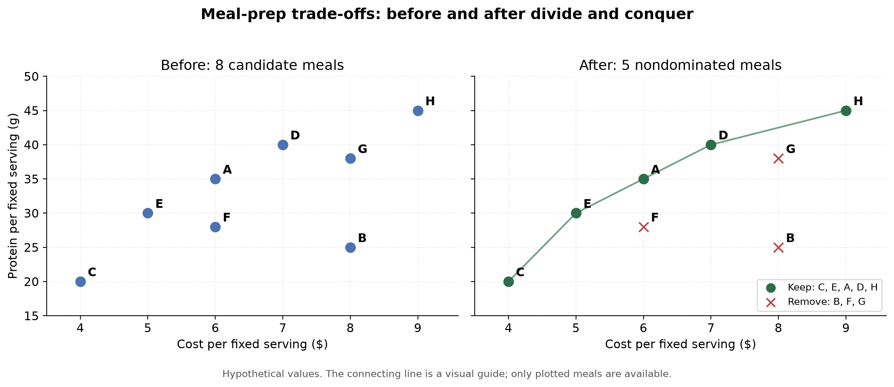
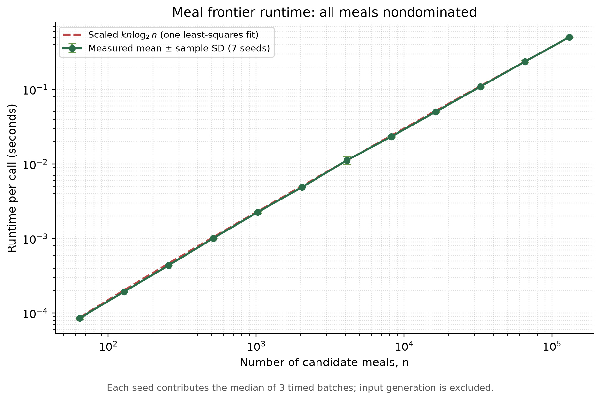

# Meal-prep Pareto frontier

COT5405 Project 1 — Nicholas Tayag.

A divide-and-conquer algorithm finds meals offering nondominated cost–protein
trade-offs: lower cost and higher protein. It recursively combines frontiers in
**O(n log n) worst-case time**, preserving ties between distinct meals.

## Files

- [Executed notebook](meal_frontier_experiment.ipynb): complete Python algorithm,
  correctness checks, runtime experiments, and results. Open it on GitHub to read.
- [Meal example](before_after_meals.png): hypothetical meals before and after filtering.
- [Runtime graph](meal_runtime_nlogn.png): measured means and standard deviations
  with an n log n reference curve.
- `requirements.txt`: dependencies for rerunning the notebook.

## Run

Use Python 3.12:

```sh
python3.12 -m venv .venv
source .venv/bin/activate
python -m pip install -r requirements.txt
jupyter lab meal_frontier_experiment.ipynb
```

Select **Restart Kernel and Run All Cells**. The notebook is self-contained and
creates an `output/` folder. Runtime values vary by machine. Machine-specific
paths in the committed notebook's display output have been normalized.

## Results

- **7,699 validation cases passed**, including comparisons with a pairwise reference.
- Runtime experiment: **64–131,072 meals**, seven seeded shuffles per size.
- Worst-case mean at 131,072 meals: **505.231 ms**.

Meal prices and protein values are hypothetical; benchmark inputs are synthetic.





## Acknowledgments

OpenAI Codex assisted with the implementation and experiments. The report's AI-use
appendix contains the detailed disclosure. 
Background: Börzsönyi, Kossmann, and Stocker,
[The Skyline Operator](https://doi.org/10.1109/ICDE.2001.914855), ICDE 2001.
